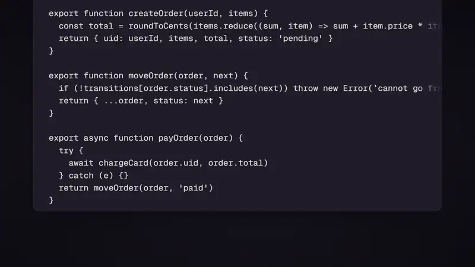

# /cleanup for Claude Code

A Claude Code plugin that fixes a whole codebase in one run. It works through 12 steps, from repo setup and dead code to naming and a final docs sync. Each step is checked against the project's own build, lint, and tests, and becomes one commit on a new `cleanup/<date>` branch. Nothing is pushed: you review the branch and merge it yourself.

<p align="center">
  <br>
  <sub>A real run over this repo's <a href="test/fixture">test fixture</a>, replayed from its git history.</sub>
</p>

## How it works

Every step goes through the same six stages:

1. **Find.** One subagent per slice of the codebase looks for the step's problems. A slice is about 50 source files, so a small repo is a single slice.
2. **Verify.** Different subagents try to disprove each finding. A fix that could change behavior must start with a test that passes on the current code.
3. **Fix.** Fixes that touch the same files go to one agent, and the rest run in parallel.
4. **Review.** Another subagent reads what each group of fixes actually changed, and flags anything that goes beyond its fix.
5. **Check.** Claude runs the project's checks itself. A step may not add a failing check.
6. **Commit.** The step becomes one commit that lists what changed, what couldn't be applied, and what needs your decision.

Changes Claude shouldn't decide alone are collected along the way and put to you at step 11.

## Requirements

- Claude Code with dynamic workflows turned on (on Pro: `/config` → Dynamic workflows). Tested on 2.1.327.
- git. On Windows, use Git for Windows: the safety hook runs through its `sh`.

Ultracode is not needed. With it on, Claude plans extra workflows of its own and the run costs more.

## Install

In Claude Code:

```
/plugin install cleanup --marketplace alfahadgm/CC-Cleanup-Skill
```

That one-step form needs Claude Code 2.1.275 or later. On older versions, run these two instead:

```
/plugin marketplace add alfahadgm/CC-Cleanup-Skill
/plugin install cleanup@cc-cleanup-skill
```

To try it without installing, start Claude Code with `claude --plugin-dir <path to a clone of this repo>`.

If you installed an earlier version by copying a `cleanup` folder into `~/.claude/skills/` or `.claude/skills/`, delete that copy.

## Usage

### Before you start

- Commit or stash your changes. The run stops if tracked files have uncommitted changes. Untracked files are left alone.
- Use auto permission mode if you can. In manual mode, Claude Code asks you to approve the step workflow: choose "Yes, and don't ask again" so it asks only once.
- Add your install, build, lint, and test commands to your allow rules, so the agents don't stop to ask.
- If a flow or rule is agreed and must stay as it is, say so in your project's `CLAUDE.md`. The agents read it, and can then tell an agreed flow from a mistake.
- Do the same for your architecture: which layers the code has, and which may use which. Stated layers are followed as written; without them the run has to infer the structure from the code.

### Commands

| Command | What runs |
|---|---|
| `/cleanup:cleanup` | All 12 steps |
| `/cleanup:cleanup dead-code security` | Only those steps, in step order |
| `/cleanup:cleanup from placement` | That step and every step after it |
| `/cleanup:cleanup in packages/api` | All steps, limited to that folder |
| `/cleanup:cleanup dead-code in packages/api` | Any of the above, limited to that folder |

The run starts by creating the `cleanup/<date>` branch and recording which checks already fail. Then it works through the steps without waiting for you, until step 11.

### Resume or abandon a run

- **Resume:** run the command again on the `cleanup/<date>` branch. It continues after the last finished step, with the same steps, checks, and baseline.
- **Abandon:** delete the `.cleanup/` folder and the `cleanup/<date>` branch.

## The 12 steps

| # | id | What it does |
|---|----|---|
| 1 | `repo-docs` | Makes .gitignore, env examples, lockfiles, CI config, and the docs match the code |
| 2 | `dead-code` | Removes code, files, dependencies, and debug leftovers that nothing uses |
| 3 | `tests` | Adds tests for critical flows, and repairs failing and skipped ones |
| 4 | `business-logic` | Simplifies how flows and state machines are coded without changing what they do, and turns stuck, unreachable, or conflicting states into questions for you |
| 5 | `security` | Moves secrets to env vars, closes missing auth checks and injection paths, patches vulnerable dependencies |
| 6 | `error-handling` | Fixes swallowed errors, missing failure paths, leaked resources, and suppressions |
| 7 | `simplify` | Inlines needless abstractions, and merges duplicated logic and styling |
| 8 | `patterns` | Moves each job (fetching, state, forms, logging, and so on) to one approach |
| 9 | `placement` | Moves code to the layer and folder the project's own structure calls for, and turns large or unclear reorganizations into questions for you |
| 10 | `naming` | Gives each concept one clear name everywhere |
| 11 | `decisions` | Asks you about the changes it won't make on its own, then applies your choices |
| 12 | `docs-sync` | Updates the docs for everything the run moved, renamed, or removed |

When you run only some steps, step 11 still runs, and so does step 12 if the run changed anything.

Performance and accessibility are not covered.

## What you get

**A branch with one commit per step.** This is the log of a run over this repo's test fixture, oldest first:

```
cleanup(repo-docs): add .gitignore, fix README run instructions
cleanup(dead-code): drop unused export of roundToCents
cleanup(tests): add tests for orders, payments, legacy invoice; re-enable skipped test
cleanup(business-logic): review order flow, no code changes
cleanup(security): move hardcoded payments API key to env var
cleanup(error-handling): add timeout and failure path to card charge call
cleanup(simplify): share roundToCents between orders and payments
cleanup(patterns): review for inconsistent patterns, none found
cleanup(placement): review code placement, no moves needed
cleanup(naming): one name per concept (userId, transitionOrderStatus, timeout constant)
cleanup(decisions): none applied (could not ask the user)
cleanup(docs-sync): docs already match the code, no changes
```

**Commit messages that say what happened.** Each one lists the changes, plus whichever of these apply: fixes not applied, items that need your decision, renames, env vars to set, and secrets to rotate. The security commit from that run:

```
cleanup(security): move hardcoded payments API key to env var

Changes:
- src/payments.js: key read from PAYMENTS_API_KEY at call time; rejects if unset
- test/orders.test.js: dummy key in payment tests; tests for header and unset case
- README.md: documented PAYMENTS_API_KEY
Set env:
- PAYMENTS_API_KEY: payments API key used as the Bearer token when charging cards
Rotate:
- payments API key found in src/payments.js (still in git history)
```

**Questions at step 11.** Claude asks about the changes it won't make on its own: external contracts (API fields, DB columns, env vars), new dependencies, any change to a business flow or rule, UX changes, and large reorganizations of files. Each question is written in everyday words for someone who isn't technical and hasn't read the code:

- what happens today, and who or what it could hurt
- the evidence: what was checked, and what the docs and tests say was intended
- what each option changes for your users, your existing flows, and the data you already store, with its advantage and its disadvantage
- which option Claude suggests, and the file and symbol it's about

One decision, as a run's commit records it:

```
- Can a cancelled order still be shipped?
  Today: The order flow lets a cancelled order move to shipped. An order that was cancelled while still unpaid can therefore be shipped without ever being paid.
  Problem: A cancelled order can still be shipped. Customers who cancelled could be sent goods, and staff could ship something that was never paid for.
  Evidence: Orders go pending to paid or cancelled, paid to shipped or cancelled, cancelled to shipped, and shipped has no way out. Nothing else in the code uses the cancelled-to-shipped step. The only test touching this is skipped and says a shipped order cannot be cancelled, which already holds. No doc or test says cancelled-to-shipped was intended. It may be a typo.
  Option 1: Make cancelled a final state with no way out. Orders already stored as cancelled can no longer be shipped. Advantage: Closes the hole that lets a cancelled or unpaid order ship. Disadvantage: Anyone relying on re-shipping cancelled orders loses that ability.
  Option 2: Keep the step as it is and record it as intended, with a test. Advantage: No behavior change. Disadvantage: Unpaid cancelled orders can still ship.
  Option 3: Let cancelled orders go back to pending (reopen) instead of shipping directly. Advantage: Shipping still requires payment. Disadvantage: Adds a new step users must learn, and it is a bigger change.
  Suggested: Make cancelled final, unless the business knowingly ships cancelled orders.
  Code: src/orders.js / transitions, moveOrder
```

Every option carries its advantage and its disadvantage. The safety hook blocks a commit in which one went missing.

In a run with nobody to ask, it leaves them all as they are and lists them.

**A summary in chat at the end.** It covers the check results before and after, what's left, the env vars you now need to set, the secrets you need to rotate, and how to review or undo a step.

## Safety

- **Its own branch.** The run never pushes, merges, or rewrites history.
- **A hook backs that up.** While a run is in progress, the plugin blocks `git push`, `git clean`, and `git reset --hard` in that repo, for Claude and for every subagent.
- **Subagents only read from git.** Claude stages and commits, after running the project's checks itself.
- **No new failures.** Checks that already failed before the run are recorded first and reported at the end. No step may add one. For a build, typecheck, or lint that already fails, the number of errors is recorded, and no step may raise it.
- **Your structure, not a new one.** Layers come from your architecture docs, lint rules, and agent instruction files where they exist. Where they have to be inferred, small moves are applied, and large or unclear ones become questions.
- **Contracts and flows are yours to change.** API shapes, routes, database schema, stored values, env var names, stored keys, published exports, and the states and rules of a business flow are returned as decisions, not edited.
- **Hands off.** Agents are told never to edit generated or vendored code, existing migrations, or real `.env` files, and never to run anything against production.
- **Secrets.** Agents are told never to print a secret's value or put it in a commit message. Removing a secret from the code doesn't remove it from git history, so the summary lists what to rotate.
- **Run state.** The run keeps its state in a `.cleanup/` folder at the repo root. The folder ignores itself and is deleted when the run finishes.

## Cost

This is a big run: up to 12 workflows, each with several agents. It scales with the repo, because every step starts one Find agent per slice.

Every agent runs on your session's model and effort level, so choose them before you start (`/model`, `/effort`). The run announces the number of slices before the first step.

For scale, all 12 steps over the six-file test fixture took 8 to 9 minutes and about $2.70 with Sonnet 5.5 on Claude Code 2.1.327.

Try a single step (`/cleanup:cleanup dead-code`) or a single folder (`in <path>`) first. On a large codebase Claude Code may show a `Large workflow` warning; it's advisory and doesn't stop the run.

## Development

### Tests

```sh
node test/step-workflow.test.mjs    # workflow script, hook guard, manifests: no agents, no cost
claude plugin validate . --strict   # plugin and marketplace manifests
bash test/run.sh dead-code naming   # a real unattended run over test/fixture; spends tokens
```

`test/run.sh` copies the fixture to a temp folder, runs `/cleanup:cleanup` there with `claude -p`, prints the cost and time, and then runs `test/check.sh`. With no arguments it runs all 12 steps.

- `CLEANUP_BUDGET_USD` caps the spend (default 25).
- `CLAUDE_FLAGS` adds flags to the `claude` call, such as `--model sonnet`.

`test/check.sh` prints one line per problem planted in the fixture:

| Status | Meaning |
|---|---|
| `ok` | The problem is fixed |
| `ASK` | The run left it as a decision for you |
| `FAIL` | Neither. After a partial run, the steps you skipped show up here |

### Repository layout

```
.claude-plugin/
  plugin.json              plugin manifest
  marketplace.json         lets this repo be added as a marketplace
skills/cleanup/
  SKILL.md                 entry point: preflight, step runner, finish
  rules.md                 rules every agent follows
  steps/                   one instruction file per step (01-repo-docs … 12-docs-sync)
workflows/
  cleanup-step.js          the one workflow script every step runs
hooks/
  hooks.json, guard.sh     block push, clean, and hard reset during a run
test/
  step-workflow.test.mjs   checks that need no agents
  fixture/                 a tiny project with one planted problem per step
  check.sh, run.sh         check a run over the fixture; run one unattended
.claude/
  CLAUDE.md                guidance for Claude Code when working on this repo
.github/
  workflows/ci.yml         runs the self-check on every push and pull request
  assets/demo.webp         the demo clip at the top of this README
```

### Releasing

Raise `version` in `.claude-plugin/plugin.json`. Installed copies stay on their version until it changes.

## License

MIT. See [LICENSE](LICENSE).
